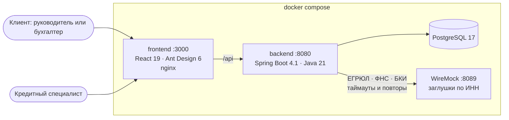

# Умный кредитный кабинет

Цифровой кредитный конвейер для малого и микробизнеса. Предприниматель в веб-кабинете идёт от задачи («нужны деньги на оборудование») до денег на счёте. Заявка тем временем проходит внутренний процесс банка: проверку, запросы в ЕГРЮЛ, ФНС и БКИ, скоринг и решение. Оба кабинета — клиента и кредитного специалиста — видят одно и то же состояние заявки в реальном времени.

Кейс «Альфа Хак 2026». Внешние сервисы заменены заглушками, данные синтетические, подписание и выдача смоделированы (см. [«Допущения»](#допущения-и-упрощения)).

## Быстрый старт

Нужны Docker 24+ с Compose v2, около 4 ГБ свободной памяти и свободные порты 3000, 8080 и 8089.

```bash
docker compose up --build
```

| Адрес                                  | Что там                                                                                    |
| -------------------------------------- | ------------------------------------------------------------------------------------------ |
| http://localhost:3000                  | Кабинет клиента и кабинет кредитного специалиста                                           |
| http://localhost:8080/swagger-ui.html  | Swagger UI. Токен берётся из `POST /api/v1/auth/login`, вставляется через кнопку Authorize |
| http://localhost:8089/__admin/mappings | Заглушки ЕГРЮЛ/ФНС/БКИ (WireMock)                                                          |

Первая сборка занимает 3–5 минут. Без файла `.env` берутся демо-значения из `docker-compose.yml`. Для своего стенда скопируйте `.env.example` в `.env` и задайте секреты.

## Сценарий проверки

У всех тестовых аккаунтов пароль `demo`. На странице входа есть кнопки быстрого входа. У каждой компании свой сценарий в заглушках, он определяется по ИНН. Полное описание — в [docs/test-scenarios.md](docs/test-scenarios.md).

| # | Логин | Что ввести в «Получить финансирование» | Что увидите |
|---|---|---|---|
| S1 | `romashka` | Купить оборудование · 3 000 000 ₽ → «Кредит на развитие» · 24 мес. · выручка 60 000 000 ₽ | Проверки идут по шагам → одобрение на условиях заявки → принять → подписать кодом → «деньги зачислены» |
| S2 | `petrov` | Купить оборудование · 8 000 000 ₽ → «Кредит на развитие» · 36 мес. · выручка 14 000 000 ₽ | **Контрпредложение 7 млн ₽** с объяснением «лимит продукта — 50% годовой выручки» и разбором баллов скоринга |
| S3 | `stroy` | Купить оборудование · 20 000 000 ₽ → «Кредит на развитие» · 36 мес. · выручка 42 000 000 ₽, документы не прикладывать | Система просит отчётность → загрузить любой файл → ручная проверка. Под `underwriter`: «Запросить информацию» → клиент отвечает → «Одобрить» |
| S4 | `zakat` | Кассовый разрыв · 1 000 000 ₽ → «Овердрафт» · выручка 8 000 000 ₽ | Автоотказ со стоп-фактором «Компания в процессе ликвидации» |
| S5 | `tishina` | Регулярные закупки · 3 000 000 ₽ → «Кредитная линия» · 24 мес. · выручка 30 000 000 ₽ | БКИ не отвечает: в истории видны 3 попытки, заявка уходит специалисту с пометкой «Не удалось получить данные: БКИ» |
| S6 | `romashka-buh` | Как в S1 | Бухгалтер готовит заявку и принимает предложение, но подписать договор может только руководитель (`romashka`) |

Кредитный специалист — логин `underwriter`. У него очередь заявок, карточка с данными источников, факторы скоринга, рекомендация движка и решение.

## Архитектура



Бэкенд — модульный монолит, пакеты в `org.kirpich.smart_profile`:

| Пакет | Что делает |
|---|---|
| `domain` | Чистая логика без БД и HTTP: статусы и переходы, кредитная политика, скоринг (`ScoringEngine`), движок решений (`DecisionEngine`) |
| `service` | Сценарии: клиент (`ClientApplicationService`), банк (`BankApplicationService`), конвейер (`PipelineService` + `PipelineScheduler`) |
| `integration` | Шлюз к внешним источникам: таймауты, «временный сбой» и «не найдено» обрабатываются по-разному |
| `web` | REST API, Problem Details (RFC 9457), сборка ответов |
| `security` | JWT (HS256), роли `DIRECTOR`, `ACCOUNTANT`, `UNDERWRITER` |
| `resources/credit-policy.yml` | Продукты, пороги и веса скоринга. Риск-менеджер меняет их без изменения кода |
| `resources/db/migration` | Схема БД (Flyway) |

Подробнее: [архитектура и решения](docs/architecture.md) · [статусы заявки](docs/state-machine.md) · [модель данных](docs/data-model.md) · [кредитная логика](docs/credit-policy.md) · [API](docs/api.md).

### Ключевые решения

- **Скоринг и решение разделены.** Скоринг выдаёт балл риска с разбором по факторам. Движок решений по правилам продукта превращает балл в исход: одобрение, контрпредложение (меньше сумма, дольше срок или другой продукт), ручная проверка или отказ. Поэтому один и тот же клиент получает разные условия по разным продуктам.
- **Проверки — шаги конвейера, а не статусы.** Статусов 8, а прогресс внутри «Проверяем заявку» показан чек-листом. Машина состояний остаётся маленькой, а клиент видит движение.
- **Сбой источника не ломает заявку.** Временная ошибка повторяется (3 попытки). Если источник так и не ответил, заявка уходит специалисту с пометкой, без отказа.
- **Решения объяснимы.** Снимки ответов источников, факторы скоринга и версия политики сохраняются вместе с решением. Журнал событий одновременно служит историей для клиента и аудитом для банка.
- **Всё внутри продукта.** Запросы документов, ответы, код подписания — только в кабинете, без email и SMS.

## Переменные окружения

| Переменная | По умолчанию | Назначение |
|---|---|---|
| `DB_URL` / `DB_USER` / `DB_PASSWORD` | `jdbc:postgresql://localhost:5432/credit` / `credit` / `credit` | Подключение к PostgreSQL |
| `APP_JWT_SECRET` | — (обязательна) | Секрет подписи JWT, не короче 32 символов |
| `REGISTRY_BASE_URL` | `http://localhost:8089` | Адрес ЕГРЮЛ/ФНС/БКИ (WireMock) |
| `PIPELINE_STEP_DELAY_MS` | `1500` | Пауза между шагами конвейера |
| `SEED_DEMO_DATA` | `true` | Загрузить демо-компании и пользователей при первом старте |
| `UPLOAD_DIR` | `./data/uploads` | Каталог для документов |
| `CORS_ORIGINS` | `http://localhost:5173,…` | Разрешённые источники для прямых запросов к API |
| `VITE_DEMO_PASSWORD` | `demo` (сборка фронта) | Пароль для кнопок быстрого входа; если пусто, кнопки только подставляют логин |

Параметры таймаутов и повторов внешних источников лежат в `backend/src/main/resources/application.yaml` (`app.registry`).

## Локальная разработка без Docker

Понадобятся JDK 21 и Node.js 24.

```bash
# 1. Заглушки: WireMock standalone 3.13.2 из Maven Central
java -jar wiremock-standalone-3.13.2.jar --port 8089 --root-dir mocks

# 2. Бэкенд на H2 в памяти — PostgreSQL не нужен
cd backend
DB_URL="jdbc:h2:mem:credit;MODE=PostgreSQL;DATABASE_TO_LOWER=TRUE;DB_CLOSE_DELAY=-1" DB_USER=sa DB_PASSWORD= \
APP_JWT_SECRET=local-dev-secret-0123456789abcdef-xyz ./mvnw spring-boot:run

# 3. Фронт: http://localhost:5173, /api проксируется на :8080
cd frontend && npm ci && npm run dev
```

## Тесты

```bash
cd backend && ./mvnw test     # 15 тестов: движок решений по сценариям S1–S5 и сквозные сценарии через API
cd frontend && npm run build  # проверка типов TypeScript и сборка
```

- `DecisionEngineTest` проверяет скоринг и решения на тех же ответах источников, что отдаёт WireMock.
- `CreditPipelineFlowTest` проходит сценарии целиком через REST API на H2. Конвейер в нём двигается вручную, а шлюз к источникам читает файлы `mocks/`. Так тесты заодно ловят расхождение заглушек и сценариев.

## Допущения и упрощения

- **ЕГРЮЛ/ЕГРИП, ФНС «Прозрачный бизнес», БКИ** — заглушки WireMock с упрощёнными контрактами. Поведение задаётся по ИНН: обычный ответ, ликвидация, просрочки, таймаут.
- **Кредитная политика условная.** Продукты и ставки упрощены по публичным страницам банка (исследование команды, `discovery/products.md`). Пороги скоринга — экспертные, не статистические.
- **Подписание** — код подтверждения в интерфейсе вместо ПЭП/КЭП. В демо код показывается на экране; в банке он пришёл бы push-уведомлением внутри приложения.
- **Выдача** — смена статуса на «Деньги выданы» без реальных операций.
- **Документы** хранятся на томе Docker. Содержимое не распознаётся, проверяется только наличие.
- **Данные синтетические:** 5 компаний, 7 пользователей ([DemoDataSeeder](backend/src/main/java/org/kirpich/smart_profile/seed/DemoDataSeeder.java)).

## Что в MVP, а что нет

**Сделано.** Подбор продукта по задаче. Автозаполнение по ИНН. Анкета и черновик. Конвейер проверок с повторами. Скоринг с объяснением. Движок решений с контрпредложениями. Запросы документов и пояснений (от системы и от специалиста). Кабинет специалиста с решениями. Подписание кодом и выдача. Роли руководителя и бухгалтера. Журнал аудита. Оптимистическая блокировка. Миграции. Тесты.

**Сознательно не делали:** реальные интеграции и электронную подпись, email/SMS (запрещено условиями), мобильное приложение (запрещено), ML-скоринг, залоги и поручительства, платные LLM.

## Как развивать

- Очередь (Kafka) между шагами конвейера и отдельный сервис скоринга. Конвейер уже разбит на независимые шаги, и каждый шаг идемпотентен.
- Keycloak вместо собственной выдачи JWT. Объектное хранилище (S3/MinIO) для документов.
- Обновления статуса через SSE вместо опроса. Центр уведомлений.
- Распознавание отчётности (OCR) для автозаполнения выручки. Open-weights LLM для краткой сводки по заявке для специалиста.
- Метрики конвейера: воронка, доля автоматических решений, время до решения (Prometheus + Grafana).

## Структура репозитория

```
backend/      Spring Boot 4.1 · Java 21 · Maven (wrapper), Dockerfile
frontend/     React 19 · TypeScript · Vite · Ant Design 6, Dockerfile + nginx
mocks/        WireMock: mappings/ и __files/ (ЕГРЮЛ, ФНС, БКИ по ИНН)
docs/         архитектура, статусы, модель данных, политика, API, тест-сценарии
docs/api/     openapi.json и Postman-коллекция
```

## Перенос в репозиторий команды

Бэкенд собран на тех же Spring Boot 4.1.1, Java 21 и в том же пакете `org.kirpich.smart_profile`, что и `backend/smart-profile` в репозитории `kirpich`. Модули `domain`, `service` и `web` переносятся как есть. Сущность `User` и роли нужно свести с уже существующими: здесь это `AppUser` и `UserRole` (`DIRECTOR`, `ACCOUNTANT`, `UNDERWRITER`).

## Сторонние компоненты

См. [THIRD_PARTY_NOTICES.md](THIRD_PARTY_NOTICES.md).
