# Архитектура

```mermaid
flowchart TB
    subgraph browser [Браузер]
        fe["SPA: React 19 · Ant Design 6<br/>кабинет клиента / кабинет специалиста"]
    end
    subgraph backend ["backend — Spring Boot 4.1 · Java 21"]
        web["web<br/>REST API · Problem Details · Swagger"]
        sec["security<br/>JWT HS256 · роли"]
        svc["service<br/>ClientApplicationService<br/>BankApplicationService"]
        pipe["PipelineService<br/>+ PipelineScheduler"]
        dom["domain<br/>ApplicationStatus · ScoringEngine · DecisionEngine<br/>credit-policy.yml"]
        integ["integration<br/>RegistryGateway"]
    end
    db[("PostgreSQL 17<br/>Flyway")]
    mocks["WireMock<br/>ЕГРЮЛ · ФНС · БКИ"]

    fe -- "HTTP /api (nginx)" --> web
    web --> sec
    web --> svc
    svc --> dom
    pipe --> dom
    pipe --> integ
    integ -- "таймаут 3 с, 3 попытки" --> mocks
    svc --> db
    pipe --> db
```

## Как проходит заявка

1. Клиент создаёт черновик и отправляет его. `ClientApplicationService` переводит заявку в `CHECKING` и создаёт шаги конвейера.
2. `PipelineScheduler` раз в `PIPELINE_STEP_DELAY_MS` вызывает `PipelineService.processTick()`. Тик продвигает каждую заявку в `CHECKING` на один шаг, каждую в своей транзакции.
3. Шаги ЕГРЮЛ/ФНС/БКИ ходят через `RegistryGateway`. Временный сбой повторяется, «не найдено» — нет. Ответ сохраняется снимком в `application_checks.result`.
4. Шаг решения собирает профиль заёмщика, считает скоринг и применяет движок решений. Результат — предложение, ручная проверка или отказ.
5. Фронт опрашивает заявку (раз в 1,5 с, пока идут проверки) и рисует чек-лист шагов.

## Почему так

| Решение | Почему | Ограничение и как развивать |
|---|---|---|
| Модульный монолит | Быстро для хакатона, одна транзакция на шаг, границы модулей уже проведены | Шаги конвейера можно вынести в отдельные сервисы с очередью (Kafka) |
| Планировщик вместо очереди | Нет лишней инфраструктуры, заявка не теряется при рестарте — состояние в БД | Один экземпляр. Для нескольких нужен `SELECT … FOR UPDATE SKIP LOCKED` или очередь |
| Политика в YAML | Продукты и пороги меняются без изменения кода, версия политики пишется в решение | В проде — справочник в БД с историей изменений и ролью риск-менеджера |
| Снимки ответов источников | Решение воспроизводимо и объяснимо, есть аудит | Объём растёт. В проде — TTL и архив |
| JWT HS256 собственной выдачи | Минимум зависимостей для демо | Keycloak / корпоративный IdP, RS256 |
| Файлы на томе Docker | Просто | S3/MinIO, антивирус, распознавание |
| Опрос вместо SSE | Надёжно и просто | SSE/WebSocket для мгновенных обновлений |

## Безопасность и надёжность

- Клиент видит только заявки своей компании: доступ проверяет сервис, чужая заявка отдаёт `404`. Банковский API доступен только роли `UNDERWRITER`.
- Подписать договор может только руководитель. Код подписания хранится хэшем.
- Пароли хранятся в BCrypt, секрет JWT берётся из окружения, приложение не стартует с секретом короче 32 символов.
- Оптимистическая блокировка заявки (`version`): одновременное решение двух специалистов даёт `409`.
- Таймауты и повторы к внешним источникам. Если источник недоступен, заявка уходит на ручную проверку, а не в отказ.
- Health-check'и (`/actuator/health`), миграции Flyway, бэкенд в контейнере работает не от root.
