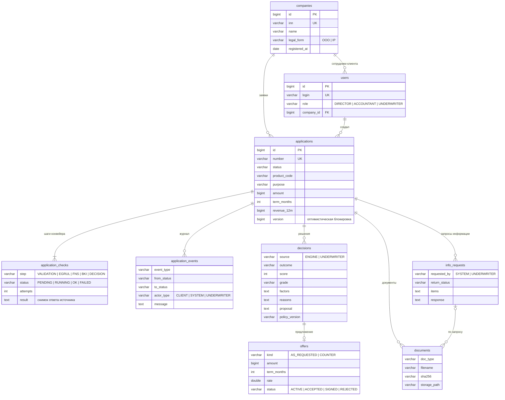

# Модель данных

PostgreSQL. Схемой управляет Flyway: [`V1__init.sql`](../backend/src/main/resources/db/migration/V1__init.sql). SQL совместим с H2 в режиме PostgreSQL — на нём идут тесты. JSON-снимки (ответы источников, факторы, предложения) хранятся в `text`.

| Таблица | Зачем |
|---|---|
| `companies`, `users` | Клиенты и сотрудники. У сотрудника банка нет компании |
| `applications` | Центральная сущность. `version` защищает от одновременной правки двумя специалистами |
| `application_checks` | Шаги конвейера и снимки ответов ЕГРЮЛ/ФНС/БКИ — данные, на которых принято решение |
| `application_events` | Только вставка. История для клиента и аудит для банка |
| `decisions` | Решения движка и специалиста: балл, факторы, причины, предложение или рекомендация, версия политики |
| `offers` | Предложение клиенту, статус принятия и подписания (хэш кода) |
| `info_requests` | Запросы документов и пояснений: кто запросил, куда вернуть заявку после ответа |
| `documents` | Метаданные файлов и SHA-256; сами файлы лежат на томе `uploads` |
