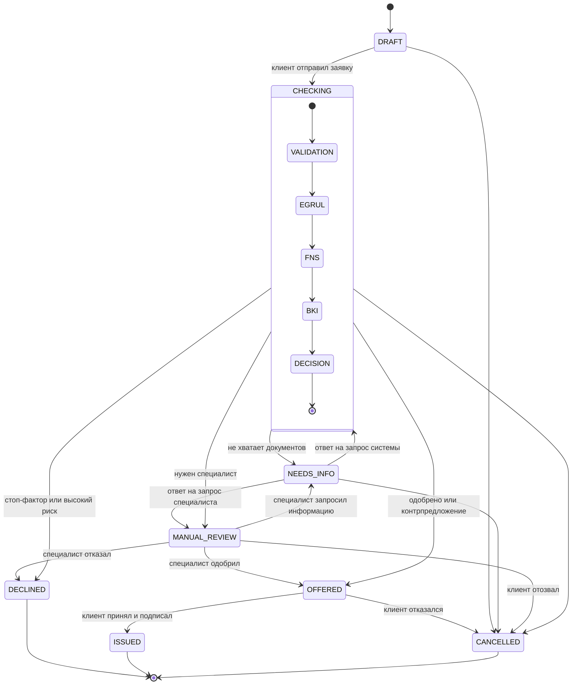

# Статусы заявки

У заявки 8 статусов. Проверки внутри `CHECKING` — не статусы, а шаги конвейера: так машина состояний остаётся маленькой, а клиент всё равно видит движение. Переходы задаёт [`ApplicationStatus`](../backend/src/main/java/org/kirpich/smart_profile/domain/ApplicationStatus.java). Недопустимый переход возвращает `409`. Каждый переход записывается в журнал событий в той же транзакции.

| Статус | Что видит клиент | Этап на шкале | Чей ход |
|---|---|---|---|
| `DRAFT` | Черновик | Заявка | клиент |
| `CHECKING` | Проверяем заявку (чек-лист шагов) | Проверка | система |
| `NEEDS_INFO` | Нужны уточнения | Проверка | клиент |
| `MANUAL_REVIEW` | Заявку изучает специалист | Решение | кредитный специалист |
| `OFFERED` | Есть предложение | Оформление | клиент |
| `DECLINED` | Отказ — с причинами | Решение | — |
| `ISSUED` | Деньги выданы | Выдача | — |
| `CANCELLED` | Заявка отозвана | — | — |

## Шаги конвейера внутри `CHECKING`

| Шаг | Что делает | При сбое |
|---|---|---|
| `VALIDATION` | Проверяет полноту: для сумм выше порога продукт требует документы | Нет документов → `NEEDS_INFO` с запросом от системы |
| `EGRUL` | Статус компании, дата регистрации, руководитель, ОКВЭД | 3 попытки, затем шаг `FAILED` → решение уходит специалисту |
| `FNS` | Налоговая задолженность, массовость, выручка по отчётности | То же. Без ФНС решение возможно |
| `BKI` | Кредиты, платежи, просрочки (нужно согласие клиента) | То же |
| `DECISION` | Профиль заёмщика → скоринг → движок решений | — |

Шаги выполняет [`PipelineService`](../backend/src/main/java/org/kirpich/smart_profile/service/PipelineService.java). Тик планировщика продвигает каждую заявку на один шаг, каждую в своей транзакции. Пауза между тиками (`PIPELINE_STEP_DELAY_MS`) нужна, чтобы на демо было видно движение.

## Запросы информации

У `NEEDS_INFO` есть поле `return_status` — куда вернуть заявку после ответа. Если запросила система, заявка возвращается в `CHECKING` и конвейер проходит заново с новыми данными. Если запросил специалист, заявка возвращается в `MANUAL_REVIEW`.
